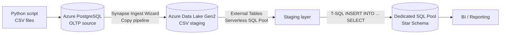
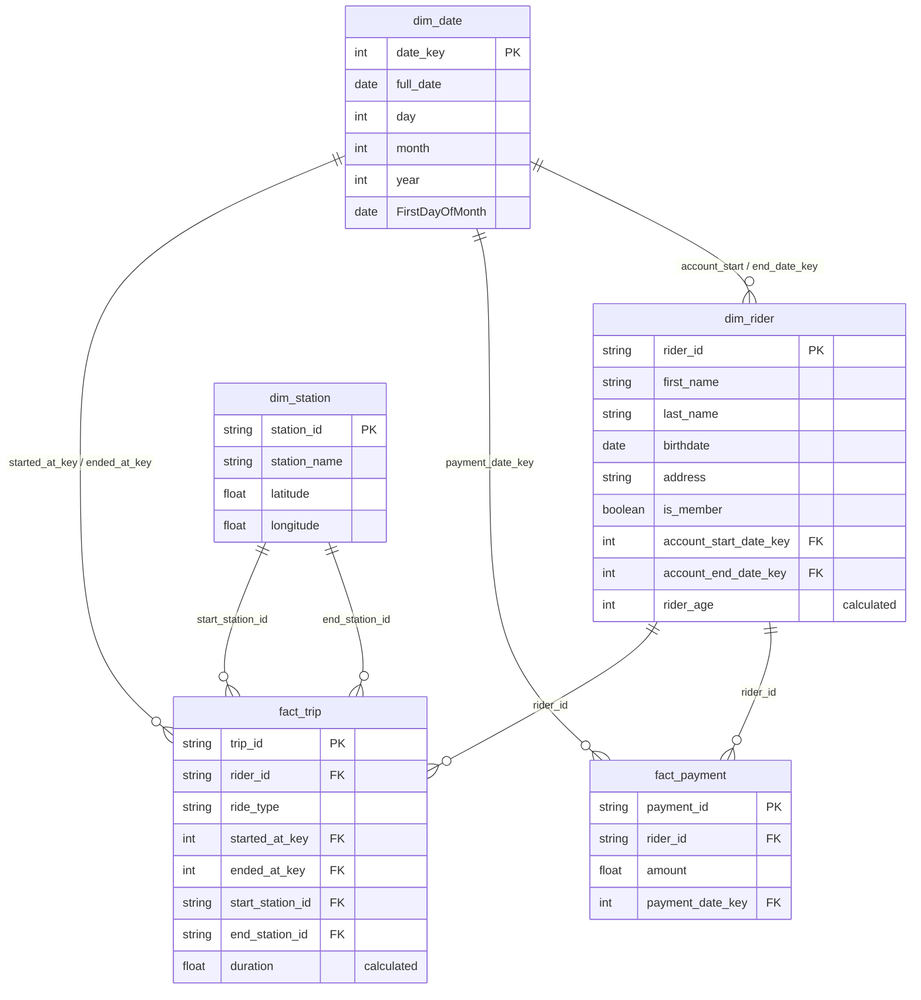
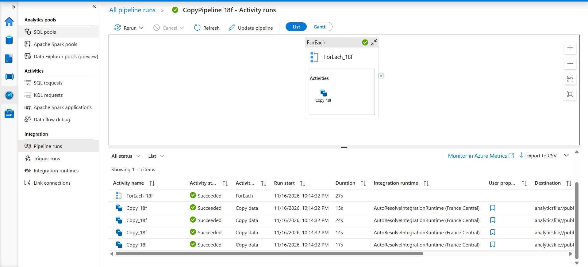
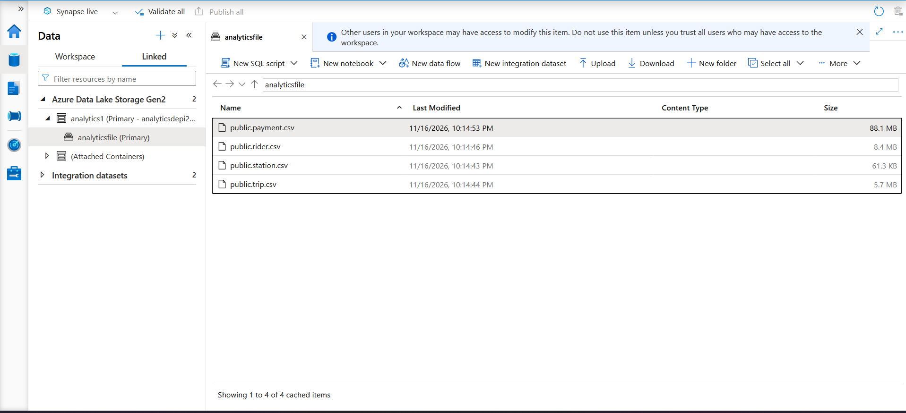
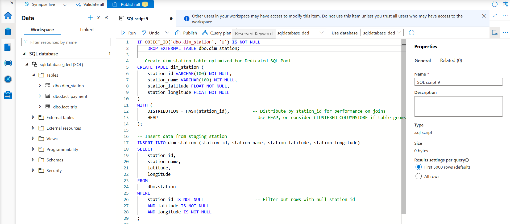
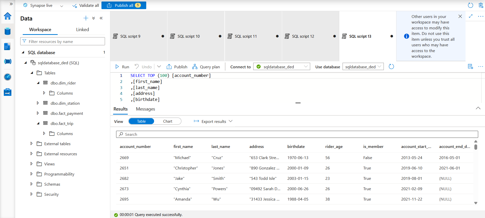

# 🚲 Azure Data Warehouse Pipeline: Bike Share Analytics


An end-to-end **ELT pipeline** that moves operational bike share data from **PostgreSQL** into a **star-schema data warehouse** on **Azure Synapse Analytics**, ready for reporting and BI.

---

## 📑 Table of Contents

- [Business Case](#-business-case)
- [Architecture](#-architecture)
- [Tech Stack](#-tech-stack)
- [Pipeline Walkthrough](#-pipeline-walkthrough)
- [Star Schema](#-star-schema)
- [Project Evidence](#-project-evidence)
- [Repository Structure](#-repository-structure)
- [Key Takeaways](#-key-takeaways)
- [Future Improvements](#-future-improvements)
- [Resources](#-resources)

---

## 💼 Business Case

A bike share company wants to analyze **rides, payments, and stations** to better understand customers and improve operations. This project ingests the operational (OLTP) data and reshapes it into a **star schema (OLAP)** that answers questions such as:

- How does trip duration vary by rider type, age group, or membership status?
- Which stations are the busiest as start and end points?
- How do payments and revenue trend by month and year?

---

## 🏗️ Architecture





---

## 🧰 Tech Stack

| Layer | Technology |
|---|---|
| Source (OLTP) | Azure Database for PostgreSQL |
| Storage / Staging | Azure Data Lake Storage Gen2 (CSV) |
| Ingestion | Synapse Ingest Wizard (Copy Data pipeline) |
| Staging access | Synapse **Serverless SQL Pool** (External Tables) |
| Warehouse (OLAP) | Synapse **Dedicated SQL Pool** |
| Transformation | T-SQL |
| Data loading | Python (`ProjectDataToPostgres.py`) |
| Verification | DBeaver |

---

## 🔄 Pipeline Walkthrough

### 1. Create Azure Resources
- Provision an **Azure Database for PostgreSQL** instance.
- Create an **Azure Synapse workspace** (with its Data Lake Gen2 account).
- Use the built-in **Serverless SQL Pool** and create a **Dedicated SQL Pool**.

### 2. Design the Star Schema
Model the warehouse around the business questions:
- **Fact tables:** `fact_trip`, `fact_payment`
- **Dimension tables:** `dim_rider`, `dim_station`, `dim_date`

### 3. Load Data into PostgreSQL
Run `ProjectDataToPostgres.py` to populate the source tables from:
`trip.csv`, `payment.csv`, `station.csv`, `rider.csv`.
Verify the load with DBeaver.

### 4. Extract to Azure Data Lake
Use the **Synapse Ingest Wizard** to copy each PostgreSQL table to the Data Lake as `.csv` files (one `Copy` activity per table inside a `ForEach`).

### 5. Load into External Tables
In the Serverless SQL Pool, create the staging layer with:
`EXTERNAL DATA SOURCE` + `EXTERNAL FILE FORMAT` + `EXTERNAL TABLE`, pointing to the CSV files in the lake.

### 6. Transform to Star Schema
In the Dedicated SQL Pool, create the final tables and populate them with `INSERT INTO ... SELECT` from the staging tables, applying cleaning rules (e.g. filtering null keys) and calculated columns.

---

## ⭐ Star Schema





### Table summary

| Table | Type | Grain / Purpose |
|---|---|---|
| `fact_trip` | Fact | One row per trip; measures: `duration` |
| `fact_payment` | Fact | One row per payment; measure: `amount` |
| `dim_rider` | Dimension | Rider profile, membership, account dates, derived `rider_age` |
| `dim_station` | Dimension | Station name and coordinates |
| `dim_date` | Dimension | Calendar attributes (day, month, year, first day of month) |

---

## 📸 Project Evidence

### Data copied from PostgreSQL to the Data Lake
All 5 copy activities in the pipeline run succeeded.



### Raw CSV files landed in Data Lake Gen2
`payment`, `rider`, `station`, and `trip` files.



### Building the dimension tables in the Dedicated SQL Pool
Example: `dim_station`, with hash distribution and null filtering.



### Final result: querying `dim_rider`
Includes the calculated `rider_age` column.



> All data used in this project is synthetic.

---

## 📁 Repository Structure

```
.
├── README.md
├── images/                      # Diagrams and screenshots
├── data_source/                 # Source CSV files
│   ├── trip.csv
│   ├── payment.csv
│   ├── station.csv
│   └── rider.csv
├── scripts/
│   └── ProjectDataToPostgres.py # Loads CSVs into PostgreSQL
└── sql/
    ├── 01_external_tables.sql   # Serverless pool: data source, file format, external tables
    └── 02_star_schema.sql       # Dedicated pool: dim/fact tables + INSERT INTO ... SELECT
```

---

## 🎯 Key Takeaways

- Designed and implemented a **star schema** from business requirements.
- Built a complete **ELT pipeline** on Azure (PostgreSQL → Data Lake → Synapse).
- Worked with **external tables** and the difference between **Serverless** and **Dedicated** SQL pools.
- Practiced warehouse design choices: table **distribution**, **HEAP vs. clustered columnstore**, and derived columns.

---

## 🚀 Future Improvements

- Orchestrate the full flow with a **Synapse pipeline** and a schedule trigger.
- Use **REPLICATE** distribution for small dimensions and **CLUSTERED COLUMNSTORE** for large fact tables.
- Add **data quality checks** and row-count reconciliation between layers.
- Build a **Power BI** dashboard on top of the star schema.
- Store credentials in **Azure Key Vault**.

---

## 📚 Resources

- [Azure Synapse Analytics documentation](https://learn.microsoft.com/en-us/azure/synapse-analytics/)
- [Azure Data Lake Storage / Blob Storage](https://learn.microsoft.com/en-us/azure/storage/blobs/)
- [PostgreSQL documentation](https://www.postgresql.org/docs/)

---

## 👤 Author

**Mazen Sabry**, Data Engineer
🔗 [[LinkedIn](https://www.linkedin.com/in/mazen-sabry-039b3a2b3/)](#) · 💻 [[GitHub](https://github.com/eng-mazensabry)](#)
